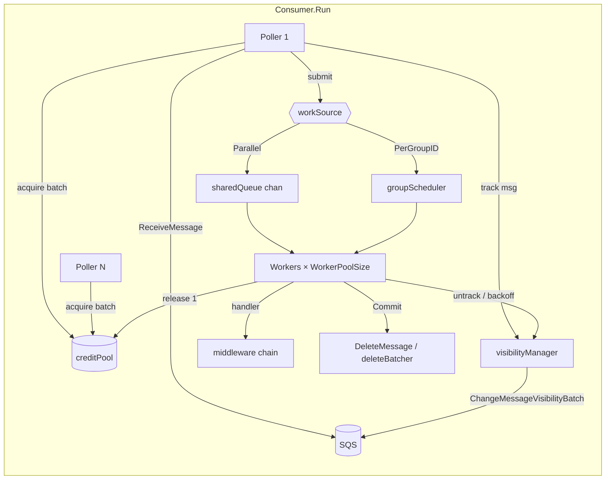

# Design Document

## Overview

This design replaces the Consumer's receive-ahead buffering with demand-driven flow
control. Four collaborators, all owned by `Consumer.Run`, replace the current
`poll` → `dispatcher.dispatch` → per-worker channel pipeline:

1. **`creditPool`**: a counting semaphore of capacity `WorkerPoolSize + Prefetch`. A Poller
   acquires one Receive_Batch of Credits before each `ReceiveMessage` call. Each
   Admitted_Message holds one Credit until it reaches an Outcome.
2. **Pollers**: `Route.Pollers()` goroutines running the receive loop. They share the
   `creditPool`, stamp each message with its Receive_Time, register it with the
   Visibility_Manager, and submit it to the work source. A Poller never waits on a Worker.
3. **`workSource`**: an interface with two implementations. `sharedQueue` (Parallel) is
   one buffered channel that every Worker drains. `groupScheduler` (PerGroupID) keeps a
   FIFO of Pending_Messages per Group_Key and a ready queue of Group_Keys, so any idle
   Worker can take any Ready_Group and at most one message per Group_Key is active.
4. **`visibilityManager`**: a single goroutine with a min-heap of Tracked_Messages ordered
   by the instant their next Extension is due (Visibility_Deadline − Renewal_Margin). It
   sends due Extensions, plus those due within the Coalesce_Window, in
   `ChangeMessageVisibilityBatch` requests of up to 10 entries. Backoff changes and
   shutdown Releases go through the same sender, so they are batched as well.

Both buffers are sized to the `creditPool` capacity, and a message is submitted only after
its Credit is held, so a Poller never blocks on a submit. The worst-case wait between
Receive_Time and handler start is bounded by Prefetch, not by `MaxMessages` × handler
duration.

The `ExtensionLimit` off-by-one is fixed as part of the Visibility_Manager rewrite: the
limit is checked against the number of Extensions already sent, before sending.

Packages that change:

- `router`: `WithPrefetch`, `WithPollers`, getters, `Mode` and `WithExtensionLimit` docs.
- `consumer`: new `creditPool`, `workSource`, `sharedQueue`, `groupScheduler`, poller loop,
  `BatchVisibilityClient`, a rewritten `visibilityManager`, a refactored `dispatcher`,
  `message` changes. `barrier.go` is removed.
- `fake`: `SQSClient` gains `ChangeMessageVisibilityBatch`.
- `benchmarks` (separate module): the in-memory client gains
  `ChangeMessageVisibilityBatch`, plus new scenarios and metrics.
- Docs: `README.md`, `consumer/doc.go`, `router/doc.go`.

Packages that do not change: `broker`, `producer`, `middleware`, `typed`, `client`,
`conn`, `idgen`, `logger`, `errors`. No new sentinel is needed: the batch-visibility
capability is detected at run time and falls back silently (Req 2.7), and option
validation already wraps with `errors.ErrInvalidOption`.

### Research summary and key design decisions

External behavior, confirmed against the aws-sdk-go-v2 `service/sqs` v1.53.0 sources in the
module cache (the version resolved by `go.mod`) and the SQS Developer Guide findings
recorded in the `opportunistic-delete-batch` spec:

- **`ChangeMessageVisibilityBatch`.** `func (c *Client) ChangeMessageVisibilityBatch(ctx,
  *ChangeMessageVisibilityBatchInput, ...func(*Options))
  (*ChangeMessageVisibilityBatchOutput, error)`. It is not deprecated. Entries are
  `types.ChangeMessageVisibilityBatchRequestEntry{Id, ReceiptHandle, VisibilityTimeout}`.
  The output carries `Successful` and `Failed []types.BatchResultErrorEntry`; a call can
  return HTTP 200 with failed entries, so per-entry results are always inspected. The
  same entry limits apply as for `DeleteMessageBatch`: at most 10 entries, unique `Id`s
  of at most 80 alphanumeric, `-`, or `_` characters.
- **Visibility semantics.** A new `VisibilityTimeout` counts from the moment of the
  `ChangeMessageVisibility` call, not from the receive. The value range is 0–43,200
  seconds. *"If you attempt to set the VisibilityTimeout to a value greater than the
  maximum time left, Amazon SQS returns an error"*: the 12-hour ceiling is cumulative from
  the receive. The Visibility_Manager therefore clamps every Extension to
  `43200 − elapsed-since-Receive_Time` and stops extending once that value is no larger
  than the time already left.
- **Release.** Setting `VisibilityTimeout` to 0 makes the message visible immediately. On
  a FIFO queue, a released tail message stays undeliverable while an earlier message of
  its group is still in flight, so Releases never break group order.
- **FIFO delivery.** SQS FIFO does not return further messages of a `MessageGroupId` while
  one of its messages is in flight. All Pending_Messages of one Group_Key in the Consumer
  therefore come from receives made while no earlier message of that group was in flight.
  This is why a Hold of every Pending_Message of the key is equivalent to, and more
  general than, the current per-batch barrier.
- **IAM.** Batch actions are authorized by their single-message action:
  `sqs:ChangeMessageVisibility` authorizes `ChangeMessageVisibilityBatch`.
- **Billing.** A batch request is billed as one request, so coalesced Extensions cost up to
  10 times less.
- **Go.** The module targets Go 1.26. `testing/synctest` is stable and already used by
  `delete_batch_test.go`, so time-dependent behavior is tested with fake time instead of
  an injected clock.
- **No new dependency.** `golang.org/x/sync/semaphore.Weighted` would fit `creditPool`, but
  it is not in `go.mod` and could not be verified with `godig` in this environment. A
  channel-based pool is ~40 lines, so it is implemented in-package.

Key decisions:

1. **Credit admission with full-batch acquire.** A Poller acquires exactly one
   Receive_Batch (`min(MaxMessages, Prefetch + 1)`) before receiving. The `Prefetch + 1`
   bound (originally `capacity`) is required: with a batch larger than `Prefetch + 1`,
   one stuck message could leave idle workers while no poller can gather a full batch.
   With fewer than `WorkerPoolSize` admitted messages, at least `Prefetch + 1` Credits are
   free, so a receive can always start while a worker is idle. Acquiring "whatever is
   free" would turn every receive under backlog into a 1–2 message receive and multiply
   `ReceiveMessage` cost. Unused Credits are returned immediately after the response.
2. **Serialized acquire.** With several Pollers, a partial acquire can deadlock: two
   Pollers each holding half of the capacity, with nothing in flight to free more. The
   pool serializes acquirers with a one-slot `turn` channel, so at most one Poller holds
   a partial acquire and the others wait for their turn.
3. **Prefetch default = `MaxMessages`.** One receive ahead hides receive latency for any
   worker count. With 30 Workers and handler time *t*, the expected wait is about
   `t × Prefetch / Workers` (≈ t/3) instead of up to `10 t`.
4. **Re-queue groups after each message.** After a message of a group completes, the
   group goes to the tail of the ready queue instead of staying on the same Worker. This
   gives fairness across groups at no cost in ordering. Draining a hot group on one Worker
   would add locality, but SQS gives no locality benefit to exploit.
5. **One Visibility_Manager goroutine with a heap.** This replaces one goroutine plus one
   ticker per in-flight message (up to 330 today) with a single goroutine. Its timer is
   always set to the earliest due instant.
6. **Coalesce_Window = 5 s, Renewal_Margin = 10 s.** When the earliest Extension is due,
   every Extension due within the next 5 s joins the batch. An early Extension is only
   included if it actually moves the deadline later (`now + k×VT > deadline`); this
   matters only at the minimum VT of 11 s.
7. **Manager requests are not canceled by the run context.** Active handlers keep running
   after cancellation until they return, and their messages still need Extensions. The
   manager therefore uses `context.WithoutCancel(ctx)`, bounds every request with
   `visibilityRequestTimeout` (5 s, the same value as `deleteRequestTimeout`), and is
   stopped explicitly by `close()` after every Worker has exited.
8. **Mutex-guarded state, not a command channel.** `track`/`untrack`/`backoff`/`release`
   take the manager mutex and wake the goroutine through a one-slot signal channel. A
   Worker never blocks behind an in-flight AWS request; it only waits for a short critical
   section.
9. **Backoff applied at handler return.** `Message.Backoff` stores the delay atomically.
   The old buffered `backoffChannel` blocked on the second call; the new design makes
   every call non-blocking with last-write-wins semantics.
10. **Release on shutdown instead of running with a canceled context.** Today buffered
    messages are run after cancellation with a canceled context: they mostly fail, their
    deletes fail, and they are redelivered after a full VT. Releasing them costs one batch
    request per 10 messages and makes them, and their FIFO groups, available to other
    consumers immediately.
11. **Removing the hash-based PerGroupID assignment** rather than keeping it as an option.
    A second strategy has no concrete use (CLAUDE.md: no abstraction without a second
    use).
12. **Delete_Batcher unchanged.** Its capacity stays `WorkerPoolSize × MaxMessages`
    (Req 12.5) and it is still closed after every Worker has exited.

## Architecture



### Message lifecycle

```
ReceiveMessage ──► admitted (holds 1 credit, tracked)
     │
     ▼
  Pending ──take──► Active ──handler──► Outcome
     │                                   ├─ success   → Commit, untrack, credit
     ├─ held (group failed) ─────────────┤─ error     → Leave, untrack, credit (+ fail group)
     │   → untrack, credit               ├─ backoff   → vm.backoff (untrack + change), credit (+ fail group)
     └─ shutdown → release ──────────────┘─ scheduled → existing logic, untrack, credit
         (untrack + change 0), credit
```

### `Consumer.Run` sequence

```go
func (c *Consumer) Run(ctx context.Context) error {
    // unchanged fail-fast checks: scheduler client, batch delete client, queue URL
    ...
    vm := newVisibilityManager(c.client, queueURL, c.route, c.log)   // detects BatchVisibilityClient
    vm.start(context.WithoutCancel(ctx))

    d := newDispatcher(...)            // builds creditPool, workSource, handler chain
    // optional deleteBatcher, unchanged
    d.startWorkers(ctx)
    d.runPollers(ctx)                  // blocks until every Poller has returned (ctx canceled)
    d.stopWorkers()                    // waits for Active_Messages to finish
    d.releasePending()                 // drain workSource → vm.release(...)
    if d.batcher != nil { d.batcher.close() }
    vm.close()                         // flushes queued backoffs/releases, then exits
    return nil
}
```

`Run` keeps returning nil on a clean shutdown and keeps its current fail-fast errors.

### Invariants

- **I1 (credit conservation):** `available + admitted = capacity` at every instant outside
  the `acquire`/receive window. During that window the acquiring Poller also counts its
  acquired Credits as admitted.
- **I2 (single Outcome):** every Admitted_Message calls `dispatcher.finish` exactly once.
  `finish` is the only place that returns a Credit.
- **I3 (group exclusivity):** for every Group_Key, `active` is true for at most one message,
  and a Group_Key is in the ready queue at most once.
- **I4 (no silent buffering):** `sharedQueue` and the `groupScheduler` ready channel both
  have capacity ≥ `creditPool` capacity, so a submit never blocks.
- **I5 (tracking window):** a message is tracked from just after its receive until its
  `finish`; no Extension request is built for an untracked message.

## Components and Interfaces

### `router` (router/options.go, router/router.go)

```go
// unsetPrefetch marks a Route whose Prefetch was not configured; New resolves it to
// MaxMessages after all options are applied.
const unsetPrefetch = -1

const defaultPollers = 1

// WithPrefetch sets how many received messages the consumer may hold beyond its
// worker pool size. The value must not be negative. The default is the route's
// MaxMessages.
func WithPrefetch(n int) Option

// WithPollers sets how many goroutines receive from the queue concurrently. All
// pollers share the route's admission capacity. The value must be at least 1. The
// default is 1.
func WithPollers(n int) Option

// Prefetch returns the number of received messages the consumer may hold beyond its
// worker pool size.
func (r *Route) Prefetch() int

// Pollers returns the number of concurrent receive goroutines.
func (r *Route) Pollers() int
```

`Route` gains `prefetch int` and `pollers int`. `New` seeds `prefetch: unsetPrefetch` and
`pollers: defaultPollers`. After applying options, if `prefetch == unsetPrefetch`, it sets
`prefetch = int(maxMessages)`. Validation errors follow the existing `fmt.Errorf` style and
are wrapped with `errors.ErrInvalidOption` by `New`.

### `creditPool` (consumer/credits.go)

```go
// creditPool bounds the number of Admitted_Messages. Acquirers are serialized so
// that a multi-credit acquire is never interleaved with another, which rules out
// partial-acquire deadlocks between pollers.
type creditPool struct {
    tokens chan struct{} // buffered, capacity = pool capacity, initially full
    turn   chan struct{} // capacity 1; holding it grants the right to acquire
}

func newCreditPool(capacity int) *creditPool

// acquire takes n credits, blocking until they are available or ctx is done. On
// ctx cancellation it returns the credits taken so far and ctx.Err().
func (p *creditPool) acquire(ctx context.Context, n int) error

// release returns n credits. Releasing more than were acquired is a programming
// error that would block; invariant I2 prevents it.
func (p *creditPool) release(n int)

// available reports the number of free credits (len(tokens)); used by tests and docs.
func (p *creditPool) available() int
```

### Pollers (consumer/poller.go)

```go
// runPollers starts route.Pollers() poll loops and waits for all of them to return.
func (d *dispatcher) runPollers(ctx context.Context)

// poll is one receive loop. It returns when ctx is canceled.
func (d *dispatcher) poll(ctx context.Context)
```

Loop body:

1. `acquire(ctx, d.receiveBatch)`. On error, return.
2. Call `ReceiveMessage` with `MaxNumberOfMessages = receiveBatch`, `WaitTimeSeconds`,
   `VisibilityTimeout`, and all attributes, exactly as today.
3. `now := time.Now()`, taken right after the call returns. This is the Receive_Time.
4. On error: `release(receiveBatch)`, then `retryAfterError` (moved unchanged from
   `consumer.go`). Return if it reports false.
5. `n := min(len(out.Messages), receiveBatch)`. `release(receiveBatch − n)`. Messages
   beyond `receiveBatch` (never returned by SQS, but a fake could) are logged at Warn
   and not admitted.
6. Build every admitted message (`newMessage`, `receivedAt = now`), `vm.track` each, then
   `d.src.submit(msgs...)` once. Submitting one by one is a bug: a worker could fail the
   head of a group before its tail from the same receive is queued, and the tail would
   then run out of order (found by `TestRun_PerGroupIDHoldsSameReceiveTailAfterFailure`).

`receiveBatch = max(1, min(MaxMessages, Prefetch + 1, 10))` is computed once in
`newDispatcher`.

### `workSource` (consumer/worksource.go)

```go
// workSource hands Pending_Messages to Workers. Implementations must never block
// submit while the caller holds a credit for the message (invariant I4).
type workSource interface {
    // submit adds an Admitted_Message as Pending.
    submit(msg *message)
    // take blocks until a Pending_Message can be started or ctx is done. ok is false
    // when ctx is done.
    take(ctx context.Context) (msg *message, ok bool)
    // complete reports that msg reached an Outcome. failed requests a group Hold;
    // the returned messages are the held Pending_Messages of the same group.
    complete(msg *message, failed bool) (held []*message)
    // drain removes and returns every Pending_Message. It is called only after
    // every Poller and every Worker has returned.
    drain() []*message
}
```

**`sharedQueue` (consumer/worksource.go):** `ch chan *message` with capacity =
`creditPool` capacity. `take` selects on `ctx.Done()` and `ch`. `complete` returns nil.
`drain` reads without blocking until the channel is empty.

**`groupScheduler` (consumer/group_scheduler.go):**

```go
type groupState struct {
    key     string
    pending []*message // receive order
    active  bool
    queued  bool       // present in ready
}

type groupScheduler struct {
    groups       map[string]*groupState
    ready        chan *groupState // capacity = creditPool capacity
    customFields []string
    mu           sync.Mutex
}
```

- `submit(msgs...)`: compute each `msg.groupKey` (the existing `groupKey` logic, moved here
  unchanged), then, under one lock for the whole receive, append to `pending`, and if `!active && !queued`, set `queued` and send to
  `ready`. The send cannot block: the number of queued groups is at most the number of
  Admitted_Messages, which is at most the capacity.
- `take`: select `ctx.Done()` or `g := <-ready`. Then lock: pop the head of `g.pending`,
  set `queued=false` and `active=true`.
- `complete(msg, failed)`: lock, set `active=false`. If `failed`, move `pending` into
  `held` and clear it. If `pending` is still non-empty, set `queued` and send to `ready`.
  Otherwise delete the group from `groups` (Req 6.7).
- `drain`: lock and collect every `pending` message from every group, in key order for
  deterministic logs. Clear the map and empty `ready`.

`groupScheduler.complete` is always called with `failed=false` under the
Scheduled_Retry_Model (Req 7.7). The dispatcher decides `failed` only when
`retryModel == VisibilityRetryModel`.

### `dispatcher` (consumer/dispatch.go, refactored)

```go
type dispatcher struct {
    client       SQSClient
    handler      middleware.Handler
    visibility   *visibilityManager
    credits      *creditPool
    src          workSource
    batcher      *deleteBatcher
    // existing fields: log, dlq, metrics, retryScheduler, dlqPublisher, scheduledRetry,
    // queueURL, queueName, retryModel, mode
    route        *router.Route
    receiveBatch int
    workers      sync.WaitGroup
}

func (d *dispatcher) startWorkers(ctx context.Context) // WorkerPoolSize goroutines
func (d *dispatcher) stopWorkers()                     // workers.Wait()
func (d *dispatcher) worker(ctx context.Context)
func (d *dispatcher) process(ctx context.Context, msg *message) (failed bool)
func (d *dispatcher) finish(msg *message)              // vm.untrack + credits.release(1)
func (d *dispatcher) hold(msgs []*message)             // Warn log + finish each
func (d *dispatcher) releasePending()                  // vm.release(src.drain()) + credits
```

`worker` loop:

```go
for {
    msg, ok := d.src.take(ctx)
    if !ok { return }
    if ctx.Err() != nil {                // taken after cancellation: release, don't run
        d.visibility.release(msg)
        d.credits.release(1)
        d.hold(d.src.complete(msg, false))
        continue
    }
    failed := d.process(ctx, msg)
    d.hold(d.src.complete(msg, failed))
}
```

`process` keeps the current outcome logic and helpers (`processScheduled`, `observeDLQ`,
`deleteMessage`, the error log). The changes:

- Visibility_Retry_Model backoff: `d.visibility.backoff(msg, msg.backoffDelay())`, then
  `d.credits.release(1)`. Returns `failed=true`. `backoff` untracks the message itself.
- Visibility_Retry_Model error: observe DLQ / log as today, `finish`, return `failed=true`.
- Success: `deleteMessage`, `finish`, return `false`.
- Scheduled_Retry_Model: `processScheduled` as today, `finish`, return `false`. A
  Backoff_Request produces no visibility change (Req 10.5).
- The per-message visibility goroutine and `msg.Dispatch()` calls are removed.
  `Dispatch` stays on the `Message` interface as a no-op-compatible marker.

`orderedGroups`, `failGroup`, `holdForOrder`, `newBatchBarrier`, `workerIndex`,
`groupIndex`, the `channels` slice, and `barrier.go` are removed. Their behavior moves into
`groupScheduler` and `hold`.

### `visibilityManager` (consumer/visibility.go, rewritten)

```go
const (
    renewalMargin            = 10 * time.Second
    coalesceWindow           = 5 * time.Second
    maxVisibilitySeconds     = int32(43200)
    visibilityRequestTimeout = 5 * time.Second
    releaseTimeout           = visibilityRequestTimeout
)

type trackedEntry struct {
    msg        *message
    deadline   time.Time // current Visibility_Deadline
    due        time.Time // deadline − renewalMargin
    extensions int
    index      int       // heap index; −1 when not in the heap
}

type visibilityChange struct {
    msg     *message
    timeout int32
    entry   *trackedEntry // nil for backoff/release
    sentAt  time.Time
}

type visibilityManager struct {
    send           visibilitySender
    log            *slog.Logger
    entries        map[*message]*trackedEntry
    heap           entryHeap        // container/heap, ordered by due
    immediate      []visibilityChange // backoffs and releases, FIFO
    wake           chan struct{}    // capacity 1
    done           chan struct{}
    queueURL       string
    visibility     time.Duration    // Visibility_Timeout
    extensionLimit int
    mu             sync.Mutex
    closing        bool
    wg             sync.WaitGroup
}

func newVisibilityManager(client SQSClient, queueURL string, route *router.Route, log *slog.Logger) *visibilityManager
func (v *visibilityManager) start(ctx context.Context)
func (v *visibilityManager) close() // sets closing, wakes, waits; flushes immediate first
func (v *visibilityManager) track(msg *message)
func (v *visibilityManager) untrack(msg *message)
func (v *visibilityManager) backoff(msg *message, delay time.Duration) // untrack + immediate
func (v *visibilityManager) release(msgs ...*message)                // untrack + immediate(0)
```

`track` creates an entry with `deadline = msg.receivedAt + VT` and pushes it on the heap
only when `extensionLimit > 0` (Req 8.5). It also records the entry in `entries`, so
`untrack` is uniform.

Run loop (`run(ctx)`):

```
loop:
  lock
  if closing && heap empty && immediate empty → unlock, return
  batch := take all immediate
  now := time.Now()
  if earliest.due ≤ now:
      pop every entry with due ≤ now + coalesceWindow     (up to any count)
      for each: timeout := nextTimeout(entry, now); skip if timeout == 0 (exhausted: drop entry)
                skip if early and now+timeout ≤ deadline (no gain; keep in heap)
                append change{entry, timeout, sentAt: now}
  unlock
  send batch in chunks of 10 (outside the lock)
  lock; apply results: success → entry.extensions++, deadline = sentAt + timeout,
        due = deadline − margin, re-push if extensions < limit and still tracked;
        failure → re-push with unchanged deadline only if still tracked and deadline > now
        (otherwise drop); log failures only for still-tracked entries or immediate changes
  unlock
  wait on: timer(earliest.due − now), wake, or (if closing) immediately loop
```

`nextTimeout(e, now)`:
`k = e.extensions + 1`; `want = k × VT`;
`remaining = maxVisibilitySeconds − ceil(now − receivedAt)`;
`t = min(want, remaining)`. Return 0 (exhausted) when `t ≤ 0` or when `now + t ≤ e.deadline`
and the entry is already due (no further progress possible within the 12-hour budget).

While `closing`, the loop keeps extending entries until they are untracked. Workers are
already stopped when `close` is called, so in practice only queued immediates remain.

### `visibilitySender` (consumer/visibility_sender.go)

```go
// visibilitySender sends up to maxVisibilityBatch changes and reports, per change
// index, nil on success or the failure to log.
type visibilitySender interface {
    send(ctx context.Context, changes []visibilityChange) []*visibilityFailure
}

// visibilityFailure carries the request error, or the per-entry code, message,
// and sender-fault flag, and renders them as slog attributes (logAttrs).
type batchVisibilitySender struct { client BatchVisibilityClient; log *slog.Logger; queueURL string }
type singleVisibilitySender struct { client SQSClient; queueURL string }
```

- `batchVisibilitySender` builds entries with `Id = strconv.Itoa(i)` and reuses
  `batchIndex` from `delete_batcher.go` to map `Failed[].Id` back to an index. Unknown ids
  are logged with the raw id and ignored. A nil output means all entries succeeded. A
  request error marks every entry failed.
- `singleVisibilitySender` issues one `ChangeMessageVisibility` per change (Req 2.7).
- Each request is bounded by `context.WithTimeout(ctx, visibilityRequestTimeout)`.

`newVisibilityManager` picks the batch sender when `client.(BatchVisibilityClient)`
succeeds.

### `BatchVisibilityClient` (consumer/client.go)

```go
// BatchVisibilityClient is implemented by SQS clients that support
// ChangeMessageVisibilityBatch. When the consumer's client implements it, visibility
// changes are sent in batches of up to ten; otherwise they are sent one by one through
// SQSClient.ChangeMessageVisibility. A concrete *sqs.Client satisfies it.
type BatchVisibilityClient interface {
    ChangeMessageVisibilityBatch(
        ctx context.Context,
        params *sqs.ChangeMessageVisibilityBatchInput,
        optFns ...func(*sqs.Options),
    ) (*sqs.ChangeMessageVisibilityBatchOutput, error)
}

var _ BatchVisibilityClient = (*sqs.Client)(nil)
```

### `message` (consumer/message.go)

- `newMessage(m types.Message, receivedAt time.Time) *message`.
- New fields: `receivedAt time.Time`, `backoffNanos atomic.Int64`.
- Removed: `backoffChannel`, `barrier`.
- `Backoff(delay)`: `backoffNanos.Store(int64(delay))`, `backedOff.Store(true)`. It never
  blocks.
- `backoffDelay() time.Duration` returns the stored delay.
- `Dispatch()` keeps its `sync.Once` close of `dispatched`, so it stays idempotent and
  safe. The Consumer no longer relies on it. Its doc comment states that the Consumer
  stops visibility management when the message reaches an Outcome.

### `fake.SQSClient` (fake/sqs_client.go)

It adds `ChangeMessageVisibilityBatchFunc`, `ChangeMessageVisibilityBatch`, and
`ChangeMessageVisibilityBatchCalls()`, following the existing `DeleteMessageBatch`
pattern: mutex-guarded call recording, and a default response that marks every entry
successful.

### Test seams (consumer/export_test.go)

The bridge exposes `NewCreditPool`/`Acquire`/`Release`/`Available`, `NewGroupScheduler`
with `Submit`/`Take`/`Complete`/`Drain` over a test message constructor
(`NewTestMessage(groupID string, receivedAt time.Time)`), and `NewVisibilityManager` with
`Track`/`Untrack`/`Backoff`/`Release`/`Start`/`Close`, plus the constants
`RenewalMargin`, `CoalesceWindow`, `MaxVisibilitySeconds`. Each helper has a doc comment.

## Data Models

| Value | Formula / default | Bounds |
| --- | --- | --- |
| Credit capacity | `WorkerPoolSize + Prefetch` | ≥ 1 |
| Receive_Batch | `min(MaxMessages, Prefetch + 1)` | 1–10 |
| Prefetch | default `MaxMessages` | ≥ 0 |
| Pollers | default 1 | ≥ 1 |
| Initial deadline | `receivedAt + VT` | — |
| Extension due | `deadline − 10 s` | ≤ deadline |
| k-th Extension timeout | `min(k × VT, 43200 − ceil(now − receivedAt))` | 1–43200 s |
| Coalesce_Window | 5 s | — |
| Backoff timeout | `clamp(int32(delay.Seconds()), 0, 43200)` | 0–43200 s (AWS rejects a value beyond the 12 h left since receive; the failure is logged) |
| Release timeout | 0 s | — |
| sharedQueue / ready capacity | credit capacity | — |
| Delete_Batcher capacity | `WorkerPoolSize × MaxMessages` (unchanged) | — |

Sizing rule documented in the README: the worst-case receive-to-finish time a message can
need is roughly `t_p99 × (1 + Prefetch / WorkerPoolSize)` plus the receive latency. With
`ExtensionLimit = n` and the growing-extension formula, the covered window from
Receive_Time is `VT + Σ_{k=1..n} (k×VT − margin)`, capped at 12 h. For PerGroupID, add
`(m − 1) × t` for a group with *m* messages in one receive.

## Error Handling

| Failure | Handling | Disposition |
| --- | --- | --- |
| `ReceiveMessage` error | Release the acquired Credits; Error log `failed to receive messages` (unchanged); wait the retry timeout (ctx-aware) | Poller retries; other Pollers unaffected |
| Credit acquire canceled | Return the partial Credits; Poller returns | Shutdown |
| More messages returned than requested | Warn log per extra message; not admitted | Becomes visible at its VT |
| Batch visibility request error | One Error `failed to change message visibility` per entry, with `queue_url`, `receipt_handle`, `visibility_timeout`, `error` | Extension: deadline unchanged, retried while `deadline > now`; Backoff/Release: message keeps its current visibility |
| Batch visibility entry failed | Same record, plus `code` and `sender_fault` | Same |
| Failed entry for a message already untracked (race with delete) | Not logged | None |
| Unknown failed `Id` | Error log with the raw `id`; no panic | None |
| nil batch output | Treated as all-successful | — |
| Delete failures | Unchanged | Unchanged |
| Handler error / panic | Unchanged (Recovery middleware owns panics) | Leave + group Hold |

No new sentinel errors and no panics. Every goroutine (Pollers, Workers, the
Visibility_Manager, the Delete_Batcher Senders) has an owner in `Consumer.Run` and exits
before `Run` returns.

## Correctness Properties

*A property is a characteristic or behavior that should hold true across all valid
executions of a system — essentially, a formal statement about what the system should
do. Properties serve as the bridge between human-readable specifications and
machine-verifiable correctness guarantees.*

### Property 1: Route option validation and defaults

*For any* integer `n`, `router.New` with `WithPrefetch(n)` succeeds iff `n ≥ 0` and then
reports `Prefetch() == n`, and with `WithPollers(n)` succeeds iff `n ≥ 1` and then reports
`Pollers() == n`. Failures match `errors.ErrInvalidOption`. *For any* valid `MaxMessages`
`m` without `WithPrefetch`, `Prefetch() == m`, and without `WithPollers`, `Pollers() == 1`.

**Validates: Requirements 1.1–1.9**

### Property 2: Credit conservation

*For any* capacity `c ≥ 1` and any interleaving of serialized `acquire(n ≤ c)` and matching
`release` calls, `available()` stays within `[0, c]`, and after every acquired Credit is
released `available() == c`. A canceled `acquire` leaves `available()` unchanged.

**Validates: Requirements 3.6, 3.7, 3.9, 3.10**

### Property 3: Admission bound and request size

*For any* route configuration (`WorkerPoolSize`, `Prefetch`, `MaxMessages`, `Pollers`),
any sequence of receive responses (sizes 0–`MaxNumberOfMessages`, errors), and any handler
latencies, the number of Admitted_Messages never exceeds `WorkerPoolSize + Prefetch`,
every `ReceiveMessage` call carries `MaxNumberOfMessages == min(MaxMessages, Prefetch + 1)`,
and no receive is issued while fewer Credits than that are available.

**Validates: Requirements 3.1–3.5, 4.2**

### Property 4: Every admitted message reaches exactly one Outcome

*For any* configuration, receive script, and handler outcome script (success, error,
backoff, scheduled success/failure), each admitted message reaches exactly one Outcome,
and after shutdown `available() == capacity`.

**Validates: Requirements 3.8, 12.1, 12.2, 12.4**

### Property 5: Parallel progress despite a stuck worker

*For any* `WorkerPoolSize ≥ 2` and any script in which one handler blocks until the test
ends, every other admitted message reaches its Outcome, and Pollers keep receiving while
Credits are available.

**Validates: Requirements 5.1–5.4**

### Property 6: Group exclusivity and order

*For any* sequence of submitted messages over any set of Group_Keys and any number of
Workers, at most one message per Group_Key is active at a time, and for each Group_Key the
handlers start in submission order.

**Validates: Requirements 6.1, 6.2**

### Property 7: Group work conservation

*For any* `WorkerPoolSize = w` and `g ≥ w` distinct Group_Keys whose handlers block, `w`
handlers are running at the same time. No Group_Key is bound to a fixed Worker: *for any*
two runs of the same group with different completion timings, the group may be served by
different Workers.

**Validates: Requirements 6.3, 6.4, 6.5**

### Property 8: Group key derivation

*For any* `MessageGroupId`, custom field names, and attribute values placed in the native
user attributes, the SNS envelope, both, or neither, the Group_Key equals the
separator-joined `MessageGroupId` and field values, with native values taking precedence.

**Validates: Requirements 6.6**

### Property 9: Hold on failure

*For any* group script under the Visibility_Retry_Model in which message *i* of a group
fails (error or backoff), no Pending_Message of that group submitted before the failure
runs its handler, none is deleted, and none receives any visibility change. Each held
message produces exactly one Warn record. Under the Scheduled_Retry_Model no message is
held.

**Validates: Requirements 7.1–7.7**

### Property 10: Group state is discarded

*For any* script, once every message of a Group_Key reaches an Outcome, the scheduler holds
no state for that key.

**Validates: Requirements 6.7**

### Property 11: Extension timing from Receive_Time

*For any* VT ≥ 11 s, `ExtensionLimit ≥ 1`, and wait before handler start (including waits
longer than VT − margin), the first Extension for a message still unfinished is sent no
later than `receivedAt + VT − margin`, and no Extension is sent earlier than
`deadline − margin − coalesceWindow`.

**Validates: Requirements 8.1, 8.2, 8.3, 8.7, 8.10**

### Property 12: Extension limit is exact

*For any* `ExtensionLimit = n ≥ 0` and a handler that outlives every Extension, exactly `n`
Extensions are sent for the message, and the k-th carries timeout
`min(k × VT, 43200 − elapsed)`.

**Validates: Requirements 8.4, 8.5**

### Property 13: 12-hour ceiling

*For any* VT and `ExtensionLimit` (including values whose `k × VT` exceeds 43200), no
visibility request makes a message invisible past `receivedAt + 43200 s`.

**Validates: Requirements 8.6**

### Property 14: No Extension after Outcome

*For any* script, after `untrack(msg)` returns, no subsequently built visibility request
contains `msg`, except its own backoff or Release change.

**Validates: Requirements 8.8, 8.9**

### Property 15: Batch shape

*For any* set of due changes, every `ChangeMessageVisibilityBatch` request has 1–10
entries, unique ids matching `^[A-Za-z0-9_-]{1,80}$`, and the route queue URL, and every
due change appears in exactly one entry.

**Validates: Requirements 9.3, 9.5, 9.6**

### Property 16: Coalescing

*For any* set of tracked messages whose due instants fall within one Coalesce_Window of the
earliest due instant, and whose due spread is below `VT − Renewal_Margin` (so an early
Extension still moves each deadline later), their Extensions are sent in
`ceil(count / 10)` requests.

**Validates: Requirements 9.4**

### Property 17: Batch failure reporting

*For any* batch response (request error, nil output, arbitrary `Failed` entries including
unknown ids), the manager does not panic, logs exactly one Error record per failed
still-tracked or immediate change with the required attributes, and leaves the deadline of
failed Extensions unchanged.

**Validates: Requirements 9.7–9.11**

### Property 18: Backoff semantics

*For any* sequence of `Backoff` calls in a handler, every call returns without blocking.
Under the Visibility_Retry_Model exactly one visibility change is sent, with timeout
`clamp(last delay seconds, 0, 43200)`, and the message is not deleted. Under the
Scheduled_Retry_Model no visibility change is sent.

**Validates: Requirements 10.1–10.5**

### Property 19: Shutdown releases pending messages

*For any* configuration and any cancellation instant, `Consumer.Run` returns only after
every Active_Message reaches its Outcome. Every Pending_Message that was not held receives
exactly one visibility change with timeout 0 and never runs its handler. No goroutine
started by `Run` remains (goleak).

**Validates: Requirements 11.1–11.4, 11.8**

### Property 20: Fallback without batch client

*For any* script run with a client that does not implement `BatchVisibilityClient`, the
Consumer runs without error and every visibility change is sent through
`ChangeMessageVisibility` with the same timeouts the batch path would use.

**Validates: Requirements 2.7**

## Testing Strategy

### Property-based tests

All property tests use `pgregory.net/rapid` with at least 100 iterations, live in
`consumer_test` / `router_test`, carry the tag
`// Feature: consumer-flow-control, Property {n}: {text}`, run time-dependent cases inside
`synctest.Test`, and check for leaks with `goleak`.

- **Property 1**: `rapid.Int()` for `n`, plus boundary generators `{-1, 0, 1}`
  (router package).
- **Property 2**: a capacity `1..64` and a sequence of operations driven by
  `rapid.StateMachine` (acquire with random `n`, release of held, canceled acquire).
  Assert `Available()` after each step.
- **Property 3**: generated route options and a fake `ReceiveMessageFunc` that returns
  scripted batch sizes and errors. Handlers block on per-message channels released in
  generated order. An atomic admitted counter is checked against the capacity inside
  `ReceiveMessageFunc`.
- **Property 4**: a generated outcome script per message across both retry models. Count
  deletes, schedules, DLQ publishes, and visibility changes per receipt handle. Assert
  exactly one Outcome per message and full Credits after `Run` returns.
- **Property 5**: `WorkerPoolSize ∈ [2,32]` with one handler blocked on a channel that
  never closes before cancellation. Assert that every other message is deleted.
- **Properties 6, 9, 10**: drive `groupScheduler` directly through the export bridge with
  generated groups (1–8 keys), message counts, Worker counts, and failure positions. Record
  start/finish events and assert exclusivity, order, holds, and an empty state at the end.
- **Property 7**: `synctest` with `w` blocking handlers on `g ≥ w` groups. Assert `w`
  concurrent starts via `synctest.Wait`.
- **Property 8**: generated attribute placements.
- **Properties 11–14, 16**: `synctest` with the export-bridge `visibilityManager` and a fake
  batch client that records `(time.Now(), entries)`. Generate VT `11..600`, limit `0..5`,
  wait offsets, and message counts `1..40`.
- **Property 15**: generated due sets of size `1..100`. Assert the shape of each recorded
  request.
- **Property 17**: generated `ChangeMessageVisibilityBatchFunc` results (error, nil output,
  random `Failed` ids including invalid ones). Capture logs with `fake` log handler.
- **Property 18**: generated delays (including negative and above 12 h) and call counts.
- **Property 19**: cancellation at a generated step. Assert release entries, handler
  invocations, and goleak.
- **Property 20**: rerun the Property 4 generator with a client wrapper that hides
  `ChangeMessageVisibilityBatch`.

### Example and integration tests (PBT not appropriate)

- `Consumer.Run` fail-fast paths are unchanged (scheduler client, batch delete, queue
  resolve): the existing tests keep passing.
- A Delete_Batch_Route combined with Pollers > 1 and PerGroupID (Req 1.10, 11.7, 12.5).
- Receive error isolation with two Pollers (Req 4.3, 4.4) under `synctest`.
- A response with more messages than requested: Warn log, not admitted.
- Integration (`-tags=integration`, MiniStack): a FIFO queue in PerGroupID mode with
  `Pollers=2`, a failing head message held and redelivered in order, and shutdown
  releasing pending messages so a second Consumer receives them before VT.

### Unit tests

- The `*sqs.Client` compile-time assertion for `BatchVisibilityClient` (Req 9.1, 9.2).
- The `fake.SQSClient` batch method default, func override, call copy, and concurrency
  (Req 13).
- `Message.Backoff` non-blocking with 1,000 calls (Req 10.1).
- The existing ordering, DLQ, scheduled-dispatch, delete-batch, metrics, and preservation
  tests are migrated off the removed internals (`barrier`, worker index). Their assertions
  stay the same, which provides the Outcome-parity evidence for Req 12.

### Benchmarks (benchmarks/ module)

New scenarios `BenchmarkFlowControl/{parallel,pergroup}/workers=30/max=10/latency=…` and
`…/pollers=2`. Custom metrics: `visibility_reqs/msg`, `receive_reqs/msg`, and
`queue_wait_ms` (the mean of handler start − Receive_Time, measured by the in-memory
client, which stamps each message at receive). The existing benchmarks stay unchanged for
comparison with the previous release.
